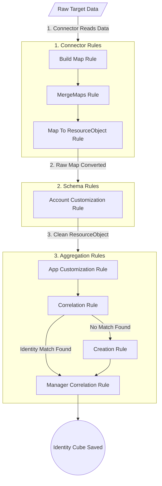
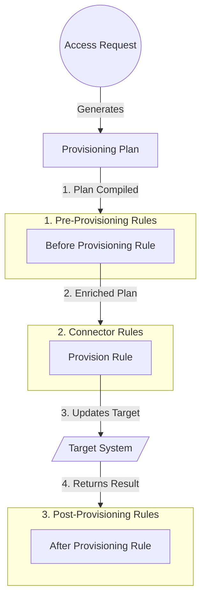

# Application Rules Execution Flow

## 1. The Two Lifecycles

In SailPoint IdentityIQ, the application rules shown in the configuration UI do not all run at the same time. They are divided into two distinct pipelines:

1. The Aggregation Pipeline (Read): Pulling data from the target application and building Identity Cubes.

2. The Provisioning Pipeline (Write): Sending access changes from IdentityIQ out to the target application.

## 2. The Aggregation Pipeline (Data Inbound)

During an account aggregation task, data flows from the raw target system into IdentityIQ. The rules execute in a strict sequence to parse, clean, and link the data.

## Execution Order (Aggregation):

### Connector Rules: (Runs first, per row of data)

1. Build Map: Takes a raw string/CSV row and turns it into a Java Map.

2. MergeMaps: If the user has multiple rows (e.g., multiple groups), it merges them into a single Map.

3. Map to ResourceObject: Converts the Java Map into a SailPoint ResourceObject.

### Schema Rules:

1. Schema Customization Rule: Modifies the raw ResourceObject (e.g., standardizing phone numbers) before IIQ's core engine touches it.

### Aggregation Rules: (Identity Engine takes over)

1. App Customization Rule: Acts identically to the Schema Customization rule (just applied at the app level instead of the specific schema level).

2. Correlation Rule: Takes the clean ResourceObject and attempts to link it to an existing Identity Cube (e.g., matching EmployeeID).

3. Creation Rule: If Correlation fails, and the app is an Authoritative Source, this rule runs to initialize a brand new Identity Cube.

4. Manager Correlation Rule: Finally, parses the manager string to link the account to the correct manager's Identity.

## 3. The Provisioning Pipeline (Data Outbound)

When a user requests access, or an automated birthright role is assigned, IdentityIQ builds a ProvisioningPlan and sends it to the target application.

Execution Order (Provisioning):

1. Before Provisioning Rule: Executes right before the plan leaves SailPoint. Used to inject missing data (like a default password, or a calculated AD sAMAccountName) into the plan so it doesn't fail.

2. Connector Rules (Provision Rule): The actual execution script (often used for JDBC, Web Services, or custom integrations) that takes the ProvisioningPlan and translates it into SQL inserts or API calls to physically create the account.

3. After Provisioning Rule: Executes after the target system confirms the operation. Used to log success/failures, send emails, or trigger ITSM tickets (like ServiceNow) if manual intervention is still needed.
